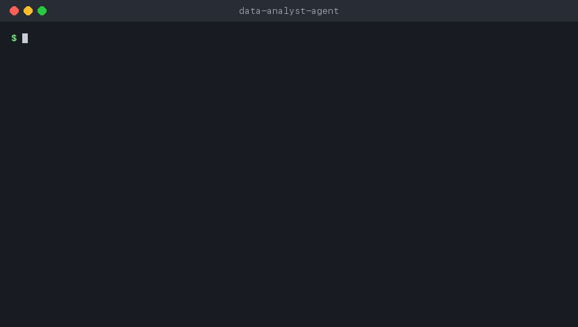
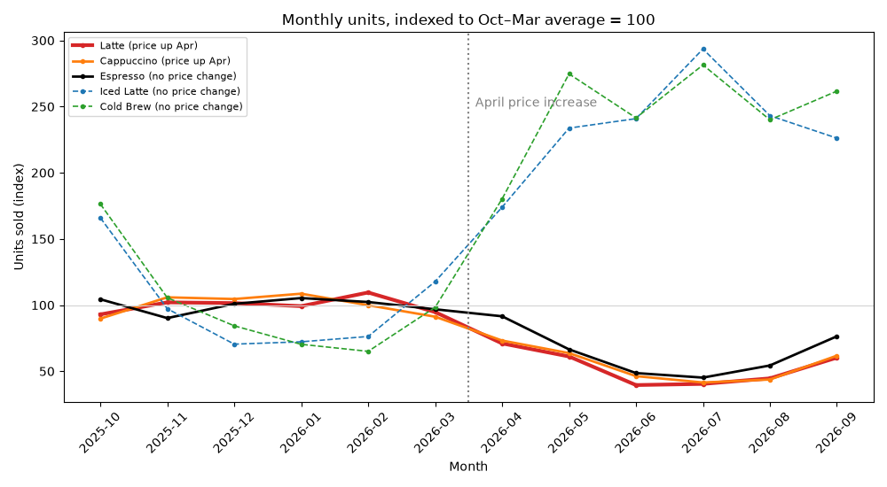

# Data Analyst Agent

[](https://github.com/adityakannan-2003/data-analyst-agent/actions/workflows/tests.yml)

Ask questions about any CSV file in plain English. The agent writes pandas code, runs it, reads the output, fixes its own errors, and draws charts. Every number in its answer comes from code it actually ran.

It's built directly on the Claude API. The agent loop is written by hand in about 70 lines (`Agent.ask` in [agent.py](agent.py)), with no agent framework.



This is a trick question. Latte sales fell 47% after the price rise, but customers also switch to iced drinks in summer, so some of that drop would have happened anyway. The agent (Sonnet 5.5, the default) compares lattes with items whose price didn't change, flags the seasonal shift and the Matcha Latte launch, and concludes the real price effect is smaller than the raw drop. The recording is real, with the model's thinking pauses shortened.

An earlier run on Opus 5.5 drew this chart for the same question, with each drink's units set to 100 for the months before the increase. Lattes and cappuccinos fall below espresso, whose price didn't change:



## How it works

```
question ─▶ Claude ─▶ tool calls ─▶ run in sandbox ─▶ results ─▶ Claude ─▶ ... ─▶ answer
                         │                               │
                   run_python(code)              output or trimmed error
                   save_chart(code, name)        file path + the PNG itself
```

Each question runs this loop until Claude stops asking for tools. The full conversation is kept, so follow-ups like "now split that by store" build on earlier answers.

## Design decisions

- **A hand-written loop instead of a framework.** `Agent.ask` calls the model, runs every tool call in the response, and sends all results back in one message. It stops when the model answers without calling a tool. It also handles the edge cases a demo usually skips: refusals, tool input cut off at the output limit, malformed tool input, a cap on steps, and rolling back the conversation on Ctrl+C or an API error.
- **Code runs in a child process with persistent state.** Variables survive between calls, the way notebook cells do. If code hangs, the parent kills the child after 60 seconds and starts a fresh one. Errors are trimmed to the lines of the agent's own code (`line 2: df['price']` / `KeyError: 'price'`) instead of 40 frames of pandas internals, so the model can see what to fix.
- **The dataset profile is sent up front.** The system prompt lists each column's type, missing count, distinct count, and example values. That saves a tool call on every question. It also flags messy data early: 32 distinct spellings for 8 products is a hint that names need cleaning.
- **The model sees its own charts.** `save_chart` returns the PNG to the model as an image, so it can notice overlapping labels or a bad scale and redraw the chart.
- **Streaming output.** The answer prints as it's written, and each tool call shows a preview of the code it runs. The request also sets `thinking.display: "updates"`, so if the model writes a short progress note between tool calls, it prints dimmed. The model's full reasoning stays hidden.
- **Prompt caching.** The growing conversation is cached between turns. The usage line after each answer shows how many input tokens came from the cache.

## Sample data

[data/coffee_sales.csv](data/coffee_sales.csv) is a year of synthetic sales at a three-store coffee chain, generated by [make_sample_data.py](make_sample_data.py). Patterns and problems were planted on purpose, so you can check whether the agent's answers are right:

| Planted pattern | What a good answer notices |
|---|---|
| Downtown is busy on weekdays, Riverside on weekends | Weekend vs. weekday split differs by store |
| Campus sales collapse in summer and over winter break | Seasonal dips at Campus only |
| Iced drinks peak in summer, hot drinks in winter | Cold Brew and Iced Latte sell about 4x more in July than in January |
| Latte and Cappuccino rose $0.50 on 2026-04-01 | Latte units fell 35% (Feb-Mar vs. Apr-May), but Espresso, whose price didn't change, fell 21% too. Spring and the Matcha launch explain most of the drop, so blaming all 35% on the price is the trap |
| Matcha Latte launched 2026-03-01 | No sales before March, so whole-year averages understate it |

| Planted problem | Correct handling |
|---|---|
| `unit_price` stored as text like `"$4.75"` | Convert to numbers before doing math |
| Product names in mixed case with trailing spaces | Normalize before grouping (32 spellings become 8 products) |
| About 1.5% of rows missing `store` | Report them or set them aside; don't drop them silently |
| 165 duplicate rows | Remove them before totaling |
| Refunds recorded as negative quantities | Count them as negative revenue |

Questions to try:

- Which store makes the most revenue, and how does that change on weekends?
- How do iced drink sales change over the year? Show me a chart.
- Did the April price increase hurt latte sales?
- What are the busiest hours at each store?
- How is the Matcha Latte doing since it launched?

## On real data

[data/stocks.csv](data/stocks.csv) is real: monthly prices for eight companies, the S&P 500 and the Nasdaq from 1990 to 2022, from Yahoo Finance. The file ships with matplotlib as sample data. It's messy in ways the coffee data isn't:

- a comment line before the header
- 133 completely empty rows
- a last row that repeats the month before
- companies that start partway through: Amazon in 1997, Google in 2004, Dell in 2016

The comment line used to stop the agent from loading the file at all. Now it skips comment lines at the top and shows them to the model.

> Which of these stocks gave investors the best return, and how did that compare with the S&P 500?

The agent, on Sonnet 5.5, answered in two tool calls:

- **Amazon gave the best return:** 33.6% a year since its 1997 listing (1,393x), against 6.0% a year for the S&P 500 over the same years.
- **Fair comparisons:** it compared each stock with the S&P 500 over that stock's own dates, so a late starter like Dell (5.7 years) isn't measured against a 32-year record.
- **Data problems, found on its own:** it dropped the empty rows and the repeated last row. It also flagged that the stock prices include dividends while the S&P 500 index doesn't, which flatters the stocks, and that the list was picked with hindsight.

All of that matches my own calculation. One slip: it says Microsoft and Apple have bigger multiples than Amazon, but its own figures show Amazon's 1,393x is the largest.

```bash
uv run python agent.py data/stocks.csv
```

## Setup

You need [uv](https://docs.astral.sh/uv/) and an Anthropic API key.

```bash
uv sync
```

```bash
cp .env.example .env
```

Open `.env` and paste in your API key. Then start a chat:

```bash
uv run python agent.py data/coffee_sales.csv
```

Or ask one question and exit:

```bash
uv run python agent.py data/coffee_sales.csv -q "Which store makes the most revenue?"
```

Options:

- `--model`: defaults to `claude-sonnet-5-5`, which passes every eval question at under half the cost of `claude-opus-5-5`. Opus is the more careful choice: it passed every question even before the prompt fix described under Evaluation.
- `--effort`: `low` to `max`, defaults to `high`. Lower is faster and cheaper; higher is more careful.
- `--out`: the folder for charts, `out/` by default.

## Tests

```bash
uv run pytest
```

No API key needed, so they also run on GitHub on every push. The sandbox tests run real code. The agent-loop tests replace the API with a fake client that returns scripted model turns: tool calls, parallel calls, malformed input, cut-off input, charts, and refusals.

## Evaluation

The tests check the code; the eval checks the answers. [evals/cases.json](evals/cases.json) has 22 questions:

- 9 about the planted patterns, including the two traps
- 6 that only come out right if the data is cleaned first
- 2 the data can't answer (profit margin, customer age), where the agent should say so instead of guessing
- 5 held-out questions, added later to check the results on traps the others don't use

Each question has checks with expected values that [evals/answer_key.py](evals/answer_key.py) computes from the data. Claude Sonnet 5.5 grades each answer against its checks, and a question passes only if every check does.

**Baseline: all 17 original questions pass on both runs** with `claude-opus-5-5` at high effort (95% interval: 82% to 100%). An answer costs about $0.05 and takes about 16 seconds. Every answer and grade is in [results.jsonl](.claude/hillclimb/analyst-answers/baseline/results.jsonl). With a perfect baseline, the eval's main use is catching regressions, for example when trying a cheaper model or lower effort.

**Opus 5.5 vs. Sonnet 5.5** on the original 17 questions, with the same tools, effort and grader:

| | Opus 5.5 | Sonnet 5.5 | Sonnet 5.5, prompt fix | Opus 5.5, prompt fix |
|---|---|---|---|---|
| Questions passed on every run | 17 of 17 | 16 of 17 | 17 of 17 | 17 of 17 |
| Matcha average question | 2 of 2 | 1 of 6 | 6 of 6 | 2 of 2 |
| Cost per answer | $0.047 | $0.020 | $0.021 | $0.049 |
| Time per answer | 16 s | 11 s | 10 s | 17 s |
| Results | [baseline](.claude/hillclimb/analyst-answers/baseline/results.jsonl) | [v1](.claude/hillclimb/analyst-answers/v1/results.jsonl) | [v2](.claude/hillclimb/analyst-answers/v2/results.jsonl) | [v3](.claude/hillclimb/analyst-answers/v3/results.jsonl) |

On the original prompt, Sonnet missed only the Matcha Latte average, which it passed in 1 of 6 runs. It either averaged over all 12 months without noting the March launch, or noticed the launch and got the figure wrong ($1,031 instead of $1,238). One line in the system prompt fixed that: when averaging over time, check that everything was around for the whole period. With it, Sonnet passes every question at under half the cost of Opus, and Opus still passes everything. I wrote the line after seeing the failure, and only the Matcha question tests it, so this shows the fix works. It doesn't show that the fix generalizes.

**Held-out check.** To test whether that result holds on problems the prompt wasn't tuned for, I wrote five more questions and froze the prompt before running them. They cover a latte price that changed mid-year, average order value, the share of orders with food, and the share of loyalty members who pay cash. The fifth asks about half-year growth, where the Matcha's late launch comes back in a different question.

| Held-out questions, 3 runs each | Sonnet 5.5 | Opus 5.5 |
|---|---|---|
| Questions passed on every run | 5 of 5 | 5 of 5 |
| Cost per answer | $0.019 | $0.040 |
| Time per answer | 10 s | 16 s |

Both models avoided every trap, and every run flagged the Matcha's growth as a launch effect. That's why the agent now defaults to Sonnet 5.5 with the prompt fix. One gap remains: I didn't run the old prompt on the growth question, so I can't say whether the prompt fix is what made Sonnet flag the Matcha there.

Sonnet also graded its own answers here, so I re-graded them with Opus. The two graders agreed on 63 of 64 checks, and the one disagreement led to a stricter check.

```bash
uv run python evals/run_eval.py
```

That runs every question twice on the default model: about $1.05 with Sonnet, including grading. Results for the setups above are committed, so running a finished variant again just prints its summary. Useful options:

- `--cases price-increase,refunds` runs only some questions.
- `--reps 1` runs each question once.
- `--variant v4 --model claude-opus-5-5` saves results for a different setup next to the others. Each variant holds one model's results; the runner refuses to mix them.
- `--regrade` re-grades saved answers after you change a check, without running the agent again.

The grader is tested too. `evals/check_judge.py` confirms that correct answers pass and bad ones fail: empty, "I don't know", an answer to a different question, two subtle mistakes the agent really made, and the trap answer for each held-out question. It costs about $0.11.

```bash
uv run python evals/check_judge.py
```

Building the eval caught problems on both sides:

- **A grader that was too lenient, twice.** It passed an answer that gave the right Matcha Latte figure and then ranked it wrongly. Later it passed one that gave the wrong figure, because the answer said the 12-month average understated the Matcha. Both are checked now, and both answers are kept in `check_judge.py` as tests.
- **A wrong answer key, twice.** The first full run failed the agent for calling February the slowest month for iced drinks, but January and February are tied (309 units each). Later, both models failed the held-out growth question on every run, because the key assumed "grew the most" meant percentage. Iced Latte wins in dollars and Cold Brew in percentage, and every answer covered both. Both keys now accept either reading. Reading failures before trusting them is what found these.

## Recording the demo

[docs/demo.gif](docs/demo.gif) is made by [scripts/make_demo_gif.py](scripts/make_demo_gif.py). The script runs the agent on a question, records everything it prints with timestamps, and draws each moment as a terminal frame with Pillow. Waits longer than 1.5 seconds are shortened, and the typing is animated.

```bash
uv run python scripts/make_demo_gif.py
```

That costs one agent run. To ask a different question, pass it as the first argument. The recording is saved to `out/demo_recording.json`, so you can adjust the look and re-render it without calling the API:

```bash
uv run python scripts/make_demo_gif.py --replay out/demo_recording.json
```

## Safety

The agent runs model-written Python on your machine with your user's permissions. The child process protects the agent from crashes and hangs. It does not stop malicious code. Two things to keep in mind:

- Only analyze files you trust. Cell values are shown to the model, so a CSV could contain text that tries to steer it.
- For untrusted data, run the agent in a container, or switch to Claude's server-side code execution tool, which runs code in Anthropic's sandbox.

## Ideas to extend it

- Run the old prompt on the half-year growth question, to see whether the prompt fix is what makes Sonnet flag the Matcha's launch.
- Try Sonnet at medium effort on the eval, to see whether it keeps 22 of 22 for less.
- Add a `--confirm` flag that shows each piece of code and waits for approval before running it.
- Support Excel, Parquet, or a SQL database as the data source.
- Put a Streamlit or Gradio front end on it, with charts shown inline.
