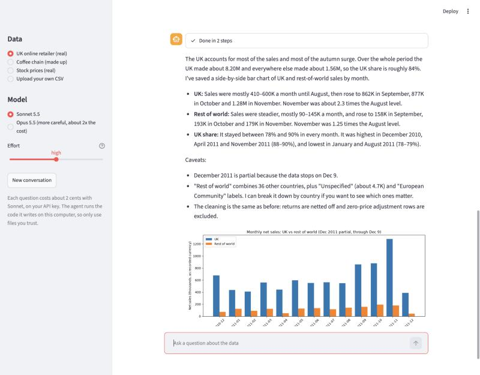

# Data Analyst Agent

[](https://github.com/adityakannan-2003/data-analyst-agent/actions/workflows/tests.yml)

Ask questions about any CSV file in plain English. The agent writes pandas code, runs it, reads the output, fixes its own errors, and draws charts. Every number in its answer comes from code it actually ran.

It's built directly on the Claude API. The agent loop is written by hand in about 70 lines (`Agent.ask` in [agent.py](agent.py)), with no agent framework.


This is real data: 541,909 transactions from a UK online shop, and the obvious answer is a trap. The two biggest sellers in raw sales were single huge orders, one of them for 80,995 paper crafts, and both were cancelled within minutes. The agent (Sonnet 5.5, the default) nets out the cancellations, finds the real best seller, and says how it counted. The recording is real, with the model's thinking pauses shortened.

## Results

Two evals check the agent's answers automatically, one on real data and one on made-up data with planted traps. Details are under [Evaluation](#evaluation).

| | Real data: UK online retailer | Made-up data: coffee chain |
|---|---|---|
| Data | 541,909 real transactions | 33,237 sales lines |
| Questions | 15 | 22 |
| Passed on every run (Sonnet 5.5) | 15 of 15 | 22 of 22 |
| Cost / time per answer | $0.017 / 9 s | $0.02 / 10 s |
| Passed on every run, code in Anthropic's sandbox | 15 of 15 | 22 of 22 |
| Cost / time per answer, in the sandbox | $0.025 / 16 s | $0.039 / 21 s |

The last two rows are the version behind the public web page, which runs the agent's code in Anthropic's sandbox instead of on your computer. See [Online version](#online-version).

## How it works

```
question ─▶ Claude ─▶ tool calls ─▶ run in sandbox ─▶ results ─▶ Claude ─▶ ... ─▶ answer
                         │                               │
                   run_python(code)              output or trimmed error
                   save_chart(code, name)        file path + the PNG itself
```

Each question runs this loop until Claude stops asking for tools. The full conversation is kept, so follow-ups like "now split that by store" build on earlier answers.

## Design decisions

- **A hand-written loop instead of a framework.** `Agent.ask` calls the model, runs every tool call in the response, and sends all results back in one message. It stops when the model answers without calling a tool. It also handles the edge cases a demo usually skips: refusals, tool input cut off at the output limit, malformed tool input, a cap on steps, and rolling back the conversation on Ctrl+C or an API error.
- **Code runs in a child process with persistent state.** Variables survive between calls, the way notebook cells do. If code hangs, the parent kills the child after 60 seconds and starts a fresh one. Errors are trimmed to the lines of the agent's own code (`line 2: df['price']` / `KeyError: 'price'`) instead of 40 frames of pandas internals, so the model can see what to fix.
- **The dataset profile is sent up front.** The system prompt lists each column's type, missing count, distinct count, and example values. That saves a tool call on every question. It also flags messy data early: 32 distinct spellings for 8 products is a hint that names need cleaning.
- **The model sees its own charts.** `save_chart` returns the PNG to the model as an image, so it can notice overlapping labels or a bad scale and redraw the chart.
- **One agent, two front ends.** The agent reports each step as it happens (a note, text, a tool call, its result, a chart) through an `on_event` hook. The terminal prints them, and the web page in [app.py](app.py) shows them live, so both show exactly what the evals tested.
- **Streaming output.** The answer prints as it's written, and each tool call shows a preview of the code it runs. The request also sets `thinking.display: "updates"`, so if the model writes a short progress note between tool calls, it prints dimmed. The model's full reasoning stays hidden.
- **Prompt caching.** The growing conversation is cached between turns. The usage line after each answer shows how many input tokens came from the cache.

## Sample data

[data/coffee_sales.csv](data/coffee_sales.csv) is a year of synthetic sales at a three-store coffee chain, generated by [make_sample_data.py](make_sample_data.py). Patterns and problems were planted on purpose, so you can check whether the agent's answers are right:

| Planted pattern | What a good answer notices |
|---|---|
| Downtown is busy on weekdays, Riverside on weekends | Weekend vs. weekday split differs by store |
| Campus sales collapse in summer and over winter break | Seasonal dips at Campus only |
| Iced drinks peak in summer, hot drinks in winter | Cold Brew and Iced Latte sell about 4x more in July than in January |
| Latte and Cappuccino rose $0.50 on 2026-04-01 | Latte units fell 35% (Feb-Mar vs. Apr-May), but Espresso, whose price didn't change, fell 21% too. Spring and the Matcha launch explain most of the drop, so blaming all 35% on the price is the trap |
| Matcha Latte launched 2026-03-01 | No sales before March, so whole-year averages understate it |

| Planted problem | Correct handling |
|---|---|
| `unit_price` stored as text like `"$4.75"` | Convert to numbers before doing math |
| Product names in mixed case with trailing spaces | Normalize before grouping (32 spellings become 8 products) |
| About 1.5% of rows missing `store` | Report them or set them aside; don't drop them silently |
| 165 duplicate rows | Remove them before totaling |
| Refunds recorded as negative quantities | Count them as negative revenue |

For the price-increase question, an Opus 5.5 run drew this chart, with each drink's units set to 100 for the months before the increase. Lattes and cappuccinos fall below espresso, whose price didn't change:


Questions to try:

- Which store makes the most revenue, and how does that change on weekends?
- How do iced drink sales change over the year? Show me a chart.
- Did the April price increase hurt latte sales?
- What are the busiest hours at each store?
- How is the Matcha Latte doing since it launched?

## On real data

The agent has been tried on two real datasets.

### A UK online retailer

The [UCI Online Retail](https://doi.org/10.24432/C5BW33) dataset has 541,909 real transactions from a UK online gift shop, 1 December 2010 to 9 December 2011 (Chen, 2015, CC BY 4.0). It's too big to keep in the repo, so a script downloads it:

```bash
uv run python scripts/fetch_online_retail.py
```

It's messy in all the ways real exports are:

- 3,836 cancelled orders, including one for 80,995 paper crafts that was cancelled 12 minutes later
- a quarter of rows with no customer ID
- 5,268 duplicate rows, and lines with zero or negative prices
- postage, Amazon fees, discounts and manual adjustments mixed in with the products
- a last month that stops on 9 December, and no Saturday sales at all

Those make good traps:

- **Best-selling product:** the obvious answer is the cancelled order.
- **Top revenue product:** the obvious answer is postage.
- **Weakest month:** the obvious answer is the one with only 9 days of data.
- **Saturday sales:** there aren't any.

The agent avoided all of them: **15 of 15 questions passed on both runs**, at $0.017 and 9 seconds per answer. The questions and results are under [Real-data eval](#real-data-eval).

### Stock prices

[data/stocks.csv](data/stocks.csv) is real: monthly prices for eight companies, the S&P 500 and the Nasdaq from 1990 to 2022, from Yahoo Finance. The file ships with matplotlib as sample data. It's messy in ways the coffee data isn't:

- a comment line before the header
- 133 completely empty rows
- a last row that repeats the month before
- companies that start partway through: Amazon in 1997, Google in 2004, Dell in 2016

The comment line used to stop the agent from loading the file at all. Now it skips comment lines at the top and shows them to the model.

> Which of these stocks gave investors the best return, and how did that compare with the S&P 500?

The agent, on Sonnet 5.5, answered in two tool calls:

- **Amazon gave the best return:** 33.6% a year since its 1997 listing (1,393x), against 6.0% a year for the S&P 500 over the same years.
- **Fair comparisons:** it compared each stock with the S&P 500 over that stock's own dates, so a late starter like Dell (5.7 years) isn't measured against a 32-year record.
- **Data problems, found on its own:** it dropped the empty rows and the repeated last row. It also flagged that the stock prices include dividends while the S&P 500 index doesn't, which flatters the stocks, and that the list was picked with hindsight.

All of that matches my own calculation. One slip: it says Microsoft and Apple have bigger multiples than Amazon, but its own figures show Amazon's 1,393x is the largest.

```bash
uv run python agent.py data/stocks.csv
```

## Setup

You need [uv](https://docs.astral.sh/uv/) and an Anthropic API key.

```bash
uv sync
```

```bash
cp .env.example .env
```

Open `.env` and paste in your API key. Then use the agent in your browser or in the terminal.

### In your browser

```bash
uv run streamlit run app.py
```

Open http://localhost:8501. Pick a dataset or upload your own CSV in the sidebar, then ask questions. Charts appear under each answer, and "How it worked" shows the code the agent ran and what came back. Follow-up questions remember the conversation.



### In the terminal

```bash
uv run python agent.py data/coffee_sales.csv
```

After each answer, the agent opens its final chart in your image viewer. Add `--no-open` to turn that off.

Or ask one question and exit:

```bash
uv run python agent.py data/coffee_sales.csv -q "Which store makes the most revenue?"
```

To use the real retail data, download it first with `uv run python scripts/fetch_online_retail.py`, then run the agent on `data/online_retail.csv`.

Options:

- `--model`: defaults to `claude-sonnet-5-5`, which passes every eval question at under half the cost of `claude-opus-5-5`. Opus is the more careful choice: it passed every question even before the prompt fix described under Evaluation.
- `--effort`: `low` to `max`, defaults to `high`. Lower is faster and cheaper; higher is more careful.
- `--out`: the folder for charts, `out/` by default.

## Online version

[hosted_app.py](hosted_app.py) is a public version of the web page. Anyone with the link can ask questions about the sample data or their own CSV, on your API key, inside a monthly budget. [DEPLOY.md](DEPLOY.md) has the setup: a separate API key with a spend limit, a Postgres database, and Streamlit Community Cloud.

A public page can't run strangers' questions as code on its own server. So this version runs the agent's code in Claude's code execution tool instead ([cloud_agent.py](cloud_agent.py)): an isolated container for each conversation, with no internet access and none of the server's secrets. The CSV goes up through the Files API and is mounted in the container, and charts come back as files. The loop has the same shape as `Agent.ask`, with one addition: a long turn can end with `pause_turn`, and sending the conversation back unchanged resumes it.

Moving the code changes how the agent works, so both evals were run again on the sandbox version, with the same questions, model and grader:

```bash
uv run python evals/run_eval.py --executor cloud --variant v4
uv run python evals/run_eval.py --suite retail --executor cloud --variant v1
```

It passed every question on both runs, 22 of 22 on the made-up data and 15 of 15 on the real data. It costs more and takes about twice as long: $0.039 and 21 seconds per answer on the coffee data, against $0.02 and 10 seconds locally. Most of the extra cost is input. The tokens written to the cache about double per answer (3,000 to 6,300 on the coffee data, 2,200 to 4,300 on the retail data), even on the retail data, where the number of steps didn't change. That points to the code execution tool's own instructions, which go with every request. On the coffee data the agent also takes more steps (3.5 against 2.6) and writes about 60% more, since Python variables don't carry over between commands in the sandbox. Every answer and grade is in [results.jsonl](.claude/hillclimb/analyst-answers/v4/results.jsonl) and [the retail results](.claude/hillclimb/retail-answers/v1/results.jsonl).

The page records every question: what was asked, the answer, the code the agent ran, the cost, the time taken, and the visitor's thumbs up or down. For uploaded files, what the code printed isn't kept. `scripts/usage_report.py` summarizes the log, and picks a random sample of live answers to grade by hand, since live questions have no answer key.

To try the page on your own computer first:

```bash
uv run streamlit run hosted_app.py
```

Without a `DATABASE_URL`, it logs to `out/usage.db`.

## Tests

```bash
uv run pytest
```

No API key needed, so they also run on GitHub on every push. The sandbox tests run real code. The agent-loop tests replace the API with a fake client that returns scripted model turns: tool calls, parallel calls, malformed input, cut-off input, charts, and refusals. The sandbox version's tests do the same for its loop: mounting the file, reusing the container, resuming a paused turn, downloading charts and deleting them from the Files API. The usage log is tested on SQLite.

## Evaluation

The tests check the code; the evals check the answers. There are two, called suites: one on made-up data, where every answer is planted, and one on real data.

### Made-up data

[evals/cases.json](evals/cases.json) has 22 questions about the coffee chain:

- 9 about the planted patterns, including the two traps
- 6 that only come out right if the data is cleaned first
- 2 the data can't answer (profit margin, customer age), where the agent should say so instead of guessing
- 5 held-out questions, added later to check the results on traps the others don't use

Each question has checks with expected values that [evals/answer_key.py](evals/answer_key.py) computes from the data. Claude Sonnet 5.5 grades each answer against its checks, and a question passes only if every check does.

**Baseline: all 17 original questions pass on both runs** with `claude-opus-5-5` at high effort (95% interval: 82% to 100%). An answer costs about $0.05 and takes about 16 seconds. Every answer and grade is in [results.jsonl](.claude/hillclimb/analyst-answers/baseline/results.jsonl). With a perfect baseline, the eval's main use is catching regressions, for example when trying a cheaper model or lower effort.

**Opus 5.5 vs. Sonnet 5.5** on the original 17 questions, with the same tools, effort and grader:

| | Opus 5.5 | Sonnet 5.5 | Sonnet 5.5, prompt fix | Opus 5.5, prompt fix |
|---|---|---|---|---|
| Questions passed on every run | 17 of 17 | 16 of 17 | 17 of 17 | 17 of 17 |
| Matcha average question | 2 of 2 | 1 of 6 | 6 of 6 | 2 of 2 |
| Cost per answer | $0.047 | $0.020 | $0.021 | $0.049 |
| Time per answer | 16 s | 11 s | 10 s | 17 s |
| Results | [baseline](.claude/hillclimb/analyst-answers/baseline/results.jsonl) | [v1](.claude/hillclimb/analyst-answers/v1/results.jsonl) | [v2](.claude/hillclimb/analyst-answers/v2/results.jsonl) | [v3](.claude/hillclimb/analyst-answers/v3/results.jsonl) |

On the original prompt, Sonnet missed only the Matcha Latte average, which it passed in 1 of 6 runs. It either averaged over all 12 months without noting the March launch, or noticed the launch and got the figure wrong ($1,031 instead of $1,238). One line in the system prompt fixed that: when averaging over time, check that everything was around for the whole period. With it, Sonnet passes every question at under half the cost of Opus, and Opus still passes everything. I wrote the line after seeing the failure, and only the Matcha question tests it, so this shows the fix works. It doesn't show that the fix generalizes.

**Held-out check.** To test whether that result holds on problems the prompt wasn't tuned for, I wrote five more questions and froze the prompt before running them. They cover a latte price that changed mid-year, average order value, the share of orders with food, and the share of loyalty members who pay cash. The fifth asks about half-year growth, where the Matcha's late launch comes back in a different question.

| Held-out questions, 3 runs each | Sonnet 5.5 | Opus 5.5 |
|---|---|---|
| Questions passed on every run | 5 of 5 | 5 of 5 |
| Cost per answer | $0.019 | $0.040 |
| Time per answer | 10 s | 16 s |

Both models avoided every trap, and every run flagged the Matcha's growth as a launch effect. That's why the agent now defaults to Sonnet 5.5 with the prompt fix. One gap remains: I didn't run the old prompt on the growth question, so I can't say whether the prompt fix is what made Sonnet flag the Matcha there.

Sonnet also graded its own answers here, so I re-graded them with Opus. The two graders agreed on 63 of 64 checks, and the one disagreement led to a stricter check.

```bash
uv run python evals/run_eval.py
```

That runs every question twice on the default model: about $1.05 with Sonnet, including grading. Results for the setups above are committed, so running a finished variant again just prints its summary. Useful options:

- `--cases price-increase,refunds` runs only some questions.
- `--reps 1` runs each question once.
- `--variant v4 --model claude-opus-5-5` saves results for a different setup next to the others. Each variant holds one model's results; the runner refuses to mix them.
- `--regrade` re-grades saved answers after you change a check, without running the agent again.

### Real-data eval

[evals/retail_cases.json](evals/retail_cases.json) has 15 questions about the retail data:

- 8 about patterns, including four traps
- 5 that only come out right if the data is cleaned first
- 2 the data can't answer (profit margin, website conversion rate)

[evals/retail_key.py](evals/retail_key.py) computes the expected values from the data.

Real data has no planted answers, and some questions have more than one fair answer. "Revenue" can be before or after cancellations, and a "product" can be a name or a stock code. So where a fair choice changes the answer, the check accepts each fair reading, as long as the answer says which one it used.

**Result: all 15 questions pass on both runs** with Sonnet 5.5, at $0.017 and 9 seconds per answer. Every answer and grade is in [results.jsonl](.claude/hillclimb/retail-answers/baseline/results.jsonl).

```bash
uv run python evals/run_eval.py --suite retail
```

That costs about $0.60, including grading.

### Testing the grader

The grader is tested too. `evals/check_judge.py` confirms that correct answers pass and bad ones fail:

- an empty answer
- "I don't know"
- an answer to a different question
- two subtle mistakes the agent really made
- the trap answer for each held-out and real-data question

It costs about $0.10 per suite.

```bash
uv run python evals/check_judge.py
```

```bash
uv run python evals/check_judge.py --suite retail
```

### What building the evals caught

Problems turned up on both sides of the grading:

- **A grader that was too lenient, twice.** It passed an answer that gave the right Matcha Latte figure and then ranked it wrongly. Later it passed one that gave the wrong figure, because the answer said the 12-month average understated the Matcha. Both are checked now, and both answers are kept in `check_judge.py` as tests.
- **A wrong answer key, three times.** The first full run failed the agent for calling February the slowest month for iced drinks, but January and February are tied (309 units each). Later, both models failed the held-out growth question on every run, because the key assumed "grew the most" meant percentage. Iced Latte wins in dollars and Cold Brew in percentage, and every answer covered both. On the real data, the agent "failed" the best-seller question on both runs, because it grouped by stock code and my key grouped by name. One stock code is sold under two names ("POPCORN HOLDER" and "SMALL POPCORN HOLDER"), so it's the top seller one way and not the other. All three keys now accept either reading.

Across both evals, 3 of the 4 failures I investigated were bugs in my answer key, not the agent. Reading failures before trusting the score is what found them.

## Recording the demo

[docs/demo.gif](docs/demo.gif) is made by [scripts/make_demo_gif.py](scripts/make_demo_gif.py). The script runs the agent on a question, records everything it prints with timestamps, and draws each moment as a terminal frame with Pillow. Waits longer than 1.5 seconds are shortened, and the typing is animated.

```bash
uv run python scripts/make_demo_gif.py
```

That costs one agent run. To ask a different question, pass it as the first argument. The recording is saved to `out/demo_recording.json`, so you can adjust the look and re-render it without calling the API:

```bash
uv run python scripts/make_demo_gif.py --replay out/demo_recording.json
```

## Safety

The agent runs model-written Python on your machine with your user's permissions. The child process protects the agent from crashes and hangs. It does not stop malicious code. Two things to keep in mind:

- Only analyze files you trust. Cell values are shown to the model, so a CSV could contain text that tries to steer it.
- For untrusted data, use the sandbox version: `uv run python cloud_agent.py data.csv -q "..."` runs the code in Claude's code execution tool, on Anthropic's servers, instead of on your machine.

## Ideas to extend it

- Run the old prompt on the half-year growth question, to see whether the prompt fix is what makes Sonnet flag the Matcha's launch.
- Try Sonnet at medium effort on the eval, to see whether it keeps 22 of 22 for less.
- Add a `--confirm` flag that shows each piece of code and waits for approval before running it.
- Support Excel, Parquet, or a SQL database as the data source.
- Give the sandbox version programmatic tool calling, which keeps Python variables between commands, and measure whether that brings its cost back down toward the local version's.
